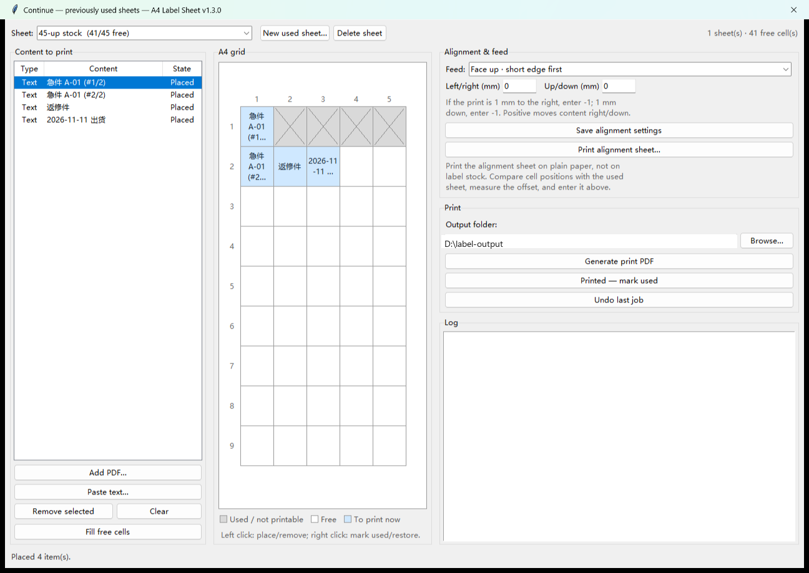
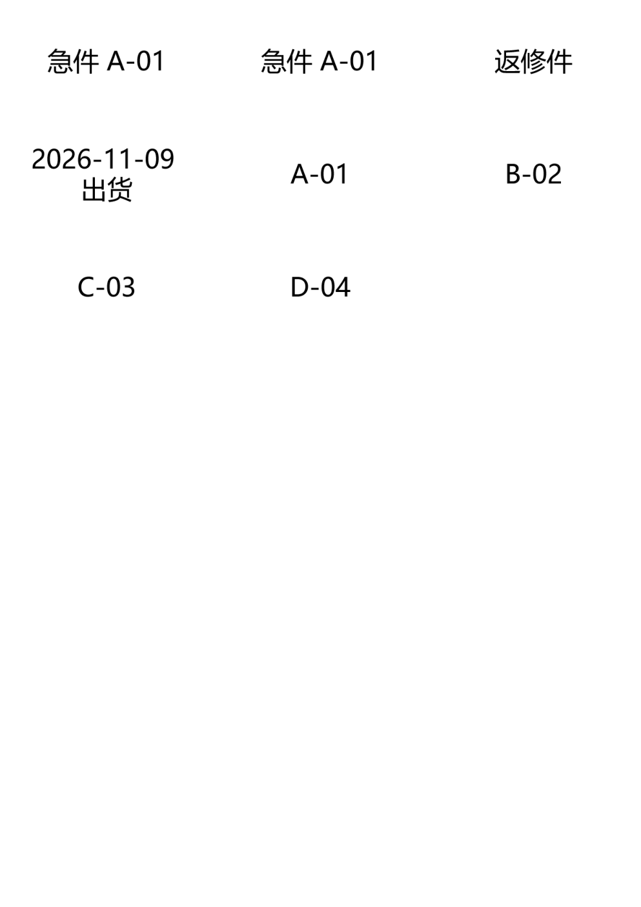
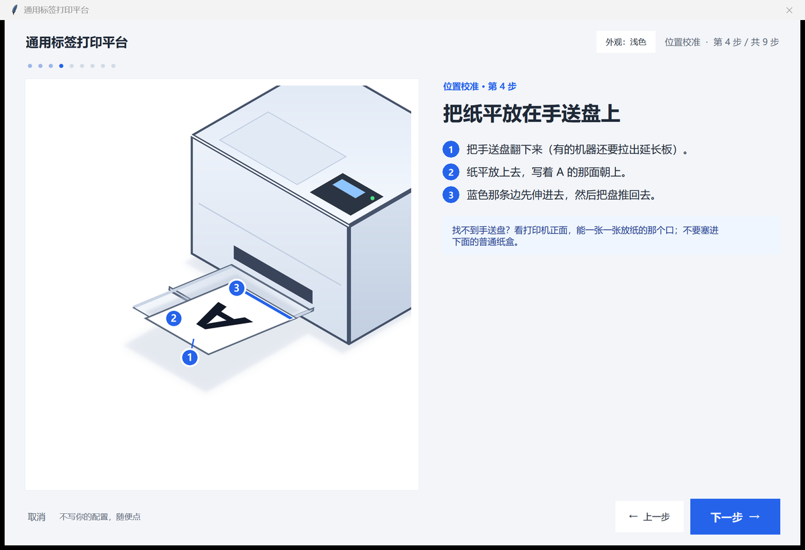
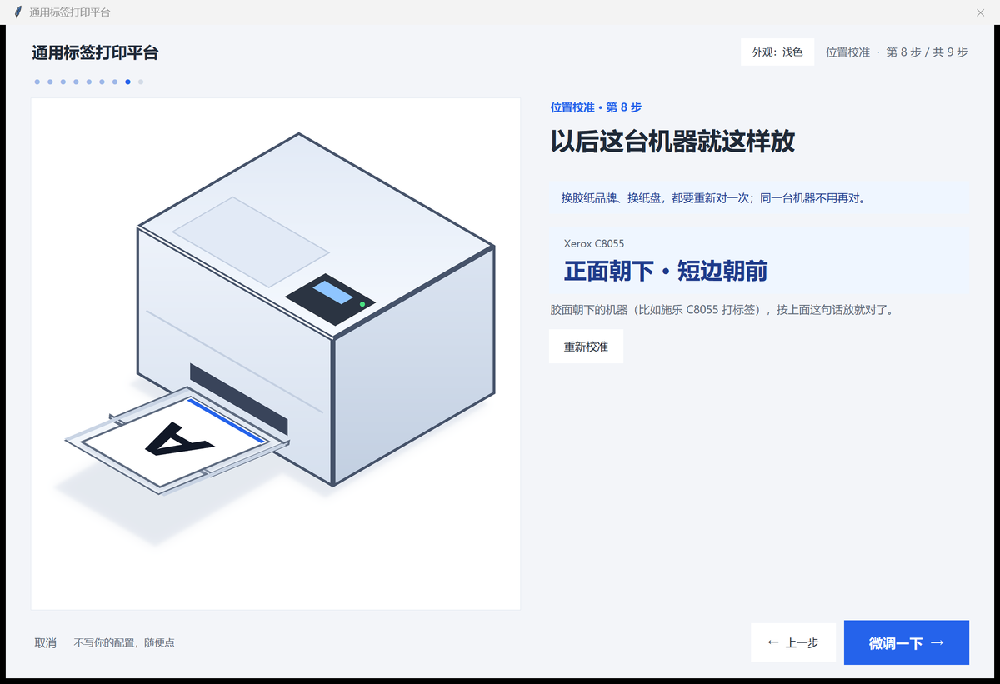

# Universal Label Printing Platform (ulpp)

[简体中文](README.md) | English

Turn **small regions of a PDF page** or **a block of plain text** into A4 pre-cut label sheets, with one copy per quantity, and get a print-ready PDF.

Two kinds of input:

1. **Table-style PDF** — each cell of the page is one record. The tool finds every cell by a text anchor,
   clips the cell content as vectors (not a screenshot), scales it into the label cell and keeps it sharp.
2. **Plain text** — one line per label, wrapped and auto-sized, rendered as a 600 dpi bitmap.

14 common A4 label presets are built in, and you can also set columns, cell size, pitch and margins yourself.
On Windows, just double-click the exe; the command line is available for batch work.
The UI defaults to the system language, and falls back to English when the system locale is neither Chinese nor English.
Since v1.3.0, you can continue on a partially used sheet: the app remembers which cells are free and prints only into them.



> Originally built to escape the tedious hand-layout grind.
> Text mode and label-size presets came later.




## Features

- **Copies by quantity**: a cell with “数量 2” produces 2 stickers, “数量 10” produces 10; copies of the same card are laid out together
- **Vector clipping**: cell content is scaled as vectors, so it stays sharp; text labels are 600 dpi bitmaps without embedded fonts, so a PDF stays small
- **Automatic text layout**: wraps lines and picks the font size automatically; alignment can be center / left / right; “uniform font size” uses one size for the whole batch.
  End a line with `|2` or ` ×2` to print that label twice (`120×80×6`-style dimensions are not mistaken for a copy count)
- **Mix PDF cards and text labels**: PDF cards come first, text labels follow, filling the same sheet
- **Three outputs per run**: print PDF (no grid lines), grid reference PDF (light gray cell lines for alignment checks), and a label list CSV
- **Built-in presets**: pick one and the columns / cell size / pitch / margins are filled in; fine-tune them for your actual stock
- **Inputs**: PDF, folder or ZIP (file names in Chinese ZIPs are decoded automatically)
- **Bilingual UI (v1.2+)**: Chinese and English, switchable in the GUI or with `--lang zh|en`; the default follows the system language, and English is used when the system locale is neither Chinese nor English
- **Continue on a used sheet (v1.3+)**: reuse a partially used label sheet; see which cells are free, click to place content or auto-fill, and print a one-page PDF; includes a plain-paper alignment sheet and left/right + up/down adjustment
- **Calibration wizard (v1.3.1+)**: answer two picture questions (which side got the ink / which edge the TOP arrow is on) instead of decoding the manual; the feed direction is stored per printer + tray

## How PDF card detection works

- Field labels such as “文件名称” (file name) are used as **anchors**; the quantity comes from “数量” (quantity)
- The field names live at the top of `src/ulpp/parser.py` (`FIELD_LABELS` and the regular expressions).
  For a different template, change those constants; the layout code does not need to change
- The number of columns and rows is **not hard-coded**; it is inferred from anchor positions. Table rules are detected and removed so they do not get scaled into labels
- A cell without an anchor is skipped, with a warning in the log

> The anchor field names are Chinese because the original template is Chinese. English PDF templates are not
> detected out of the box; change `FIELD_LABELS` for your own template.

## Built-in label presets

| Preset | Columns × rows | Cell |
| --- | --- | --- |
| 45 labels (measured stock) | 5×9 | 40 × 30 mm, pitch 41.5×32 |
| 24 labels | 3×8 | 70 × 37 mm |
| 21 labels | 3×7 | 70 × 42.3 mm |
| 30 labels | 3×10 | 70 × 29.7 mm |
| 12 labels | 2×6 | 99 × 49.5 mm |
| 10 labels | 2×5 | 99 × 59.4 mm |
| 8 labels | 2×4 | 99 × 74.25 mm |
| 6 labels | 2×3 | 99 × 99 mm |
| 4 labels | 2×2 | 105 × 148.5 mm |
| 2 labels | 1×2 | 210 × 148.5 mm |
| 40 labels | 4×10 | 48 × 25 mm |
| 72 labels | 6×12 | 33 × 23 mm |
| 65 labels | 5×13 | 38 × 22 mm |
| 44 labels | 4×11 | 46 × 25 mm |

> Cut lines differ by 0.5–1 mm between batches. After choosing a preset, print one “grid reference”,
> overlay it on the real label stock against a light, and adjust “pitch Y / top margin / inset” if needed.

## Three ways to use it

### 1. No install: download the exe

Get `ulpp.exe` from [Releases](../../releases), double-click it, and no Python is needed.

> The unsigned exe may be blocked once by Windows Defender / SmartScreen: choose “More info → Run anyway”.
> If that is a problem, run from source; the result is identical.

### 2. Run from source

```bash
git clone https://github.com/<your-name>/ulpp.git
cd ulpp
pip install -r requirements.txt
pip install -e .            # makes `python -m ulpp` find the package in src/
python run_gui.pyw          # Windows GUI
python -m ulpp       # any platform (no arguments opens the GUI)
```

> If you prefer not to install the package, set `PYTHONPATH=src` before running `python -m ulpp`.

### 3. Command line (batch / scheduled jobs)

> Run these from the repository root; for a source checkout, run `pip install -e .` first
> (or set `PYTHONPATH=src`).

```bash
# Table-style PDF
python -m ulpp input.zip -o output
python -m ulpp some-folder --first-page-only --no-proof
python -m ulpp form.pdf --preset 24

# Text labels only (one line per label; |2 = print two)
python -m ulpp --lang en --text "URGENT A-01 |2" --text "REWORK" -o output
python -m ulpp --lang en --text-file list.txt --text-uniform

# Mixed
python -m ulpp form.pdf --text "Rush |2" --preset 45

# English UI for one command
python -m ulpp --lang en --list-presets

python -m ulpp --list-presets        # list all presets
python -m ulpp --save-config g.json  # save a grid, reuse with --config g.json
```

`python -m ulpp -h` lists every option. `--preset` accepts the stable id (`45`, `24`, …),
the English name, or the old Chinese name, so existing scripts keep working.

## Using the GUI

1. **1  PDF files** (optional): use “Add PDF / Add folder / Add ZIP”. With `tkinterdnd2` installed, you can also drop files onto the list
2. **2  Text labels** (optional): one line per label, `|2` at the end prints two; choose alignment and “uniform font size”
3. **3  Output options**: all pages / first page only; whether to generate the grid reference and CSV; output folder
4. **4  Label preset & grid**: choose a preset to fill in the dimensions, then fine-tune for the actual label edges
5. Click **Generate**, then “Open output folder”

The language selector at the bottom right switches between **中文** and **English** immediately; files, text and
grid settings are kept. Without a choice, the language follows `--lang` (if given), then `LC_ALL` / `LANG`,
then the system locale; when the system locale is neither Chinese nor English, it uses English.

Click **Continue…** at the bottom right to open the continue window; the full-sheet flow is unchanged.

## Calibration wizard (v1.3.1)

“Face up or face down, which edge goes in first” differs per printer, and manuals are often
written backwards. The wizard turns it into two picture questions anyone can answer.

Where: **Continue** window → Alignment & feed → **Not sure how to load it? Open the calibration wizard…**
(the feed dropdown is still there if you already know the answer).



Nine steps: pick printer → write a big A → confirm the A side is up → lay it on the bypass tray
(with a loading animation) → print an orientation test page (plain paper) → “which side got the ink?”
→ “which edge is the TOP arrow on?” → conclusion → fine-tune.



- The test page is **A4 300 dpi on plain paper** with a TOP arrow, a big A and a thick black bar,
  so you can tell which side got the ink even from the back. Print it at **100% actual size** —
  never “fit to page”.
- The result is stored in the same per-printer calibration (the four dropdown values) and comes back
  automatically next time.
- Chinese / English, two themes (light / mono).

> It solves the **direction**, not the **die-cut size**. Real cell positions have to be measured
> from a scan (see Limitations).

## Continue on a used sheet

1. **New used sheet**: pick a built-in preset, or choose “Custom” and enter columns, rows, cell size and pitch (for example 3×4).
2. **Mark used cells**: right-click a used cell to turn it gray; right-click again to restore it.
3. **Place content**: add PDF cards or paste text on the left; select an item and left-click a free cell to place it there, or click “Fill free cells”.
4. **Generate print PDF**: only the selected cells are printed; everything else stays blank. Print at **100% actual size**, one sheet at a time.
5. **After printing**: click “Printed — mark used”; “Undo last job” restores the cells.
6. **Alignment**: click “Print alignment sheet…”; it generates a **plain-paper** reference page. Compare its cell positions with the used sheet, then enter the left/right and up/down adjustment. The marks are never printed on the label sheet.

Sheet records are stored in `%APPDATA%\ulpp\sheets.json` (Windows) or `~/.config/ulpp/sheets.json`;
an older `inventory.json` is migrated automatically.

Limitations (v1.3.1):

- **Built-in presets are only a starting point**: every die-cutting batch differs (one measured
  45-up A4 sheet was spec'd at 41.5 mm pitch but measured 42.26 mm — about 3 mm off by the fifth column).
  Today you align with the grid reference sheet plus the left/right and up/down adjustment;
  the next step is **scan-based measurement** (local, no network, no AI)
- Free cells are maintained manually; scan-based cell recognition is still planned
- Only print on cells whose labels are still attached; peeled/bare liner cells are marked used and must not be printed
- Consumer printers repeat to about ±1–2 mm; calibrate with the alignment sheet and one test print first
- Laser printers are preferred; inkjet printing on previously used label stock can smudge or curl
- A3 is not supported yet; the page size is kept in the data model for later

## Output

| File | Purpose |
| --- | --- |
| `*_print.pdf` | Print directly on label stock (no grid lines) |
| `*_grid-reference.pdf` | Print on plain paper, overlay on the label stock, check cell alignment |
| `*_label-list.csv` | For every sticker: sheet, cell, source (PDF/text), name, quantity, copy number |
| `*_continue.pdf` | Only the free cells of a used sheet |
| `*_continue-list.csv` | Cell list for a continue job |

> File names are localized too: a Chinese UI writes `*_打印版.pdf`, `*_网格参考版.pdf`, `*_标签清单.csv`,
> `*_接着打.pdf` and `*_接着打清单.csv`; an English UI writes the names above. The default prefix is
> `标签` / `label`, and the default output folder is `标签输出` / `label-output`.

## Project layout

```
ulpp/
├─ src/ulpp/
│  ├─ config.py      # grid parameters (GridSpec)
│  ├─ presets.py     # common A4 label presets (stable ids + localized names)
│  ├─ parser.py      # PDF parsing: find cards, read fields, compute content boxes
│  ├─ textlabel.py   # text layout: tokenize, wrap, auto-size, render bitmap
│  ├─ imagex.py      # write bitmaps as PDF image XObjects (1-bit + Flate)
│  ├─ builder.py     # layout output: Form XObject / image + clip + scale
│  ├─ sheets.py      # used-sheet records: cells used, alignment settings
│  ├─ calibration.py # plain-paper alignment sheet
│  ├─ partial_gui.py # continue window (grid, placement, mark used)
│  ├─ i18n.py        # runtime i18n: JSON packs, system language, tr()
│  ├─ locales/       # zh_CN.json / en_US.json
│  ├─ cli.py         # command line
│  ├─ gui.py         # tkinter GUI
│  └─ __main__.py    # arguments → CLI; no arguments → GUI
├─ packaging/        # PyInstaller specs and scripts
├─ tests/            # unit and end-to-end tests
└─ .github/workflows/build-windows.yml   # build and publish a Release on tag
```

## Technical notes

- Parsing uses **pdfplumber** (text and line coordinates): the word containing a field label is the anchor,
  words are assigned to the nearest column start, grouped into lines by `top`, and collected from the anchor
  line until the next “文件名称”.
- PDF output uses **pypdf**: each source page becomes a **Form XObject** (embedded once), then drawn into a
  cell with “clip path + scale matrix + `Do`”. **The clip box must be the content box, not the whole cell**,
  otherwise neighbouring content leaks into the inset.
- Text output uses **Pillow** to render a 600 dpi 1-bit image, written as an `/Image` XObject (Flate).
  No Chinese font is embedded: labels are small, a bitmap is visually indistinguishable from vectors when
  printed, and the PDF does not grow by ten megabytes.
- Table-line detection: thin lines spanning a large part of the page are treated as rules and removed, so
  table borders do not get scaled into labels.
- i18n: two JSON packs; a test asserts that their key sets are identical, that placeholders match, and that
  every `tr()` key used in the source exists. Missing packs or keys fall back to Chinese with a warning.
- Continue on a used sheet: `build_partial_pdf()` draws only the requested cell numbers on one page.
  The left/right and up/down adjustment shifts the cell before clipping, so content stays inside the
  label. Sheet records are stored locally; cells are marked used after the user confirms the print, and
  the last job can be undone.

## Development and packaging

```bash
pip install -r requirements.txt
pip install -e .
python -m unittest discover -s tests -t .
```

```powershell
powershell -ExecutionPolicy Bypass -File packaging\build.ps1
# artifact: dist\ulpp.exe (single file, about 36 MB)
```

For local testing, a `--onedir` build avoids the single-file extraction problem in sandboxed environments:

```powershell
python -m PyInstaller packaging\ulpp_onedir.spec --noconfirm
# artifact: dist\ulpp\ulpp.exe
```

Or use GitHub Actions: push a tag such as `v1.3.0` and the workflow builds and attaches the exe to the Release.

## Platform support

| Platform | Status | Extra requirements |
| --- | --- | --- |
| Windows 10/11 | main target, exe provided | none |
| macOS | source works | Python 3.9+ (python.org builds include tkinter; Homebrew needs `brew install python-tk`) |
| Linux | source works | `python3-tk`; text mode needs a font (DejaVu Sans for English, `fonts-wqy-microhei` for Chinese) |

Continue printing needs a printer that can feed a single sheet manually or from a side tray; whether a
paper tray accepts a partially used sheet depends on the model.

The exe is Windows-only; on macOS/Linux use `python -m ulpp`.
The “Open output folder” button only shows the path on macOS/Linux.

## FAQ

**Q: No cards detected?**
A: This mode is for table-style PDFs where each cell is a record. Scanned pages (one big image) or PDFs
without the expected field names cannot be parsed. Use text mode instead, or edit the field names at the
top of `parser.py`.

**Q: Text labels vary in size?**
A: By default each label uses the largest size that fits. Tick “Uniform font size” to use one size for the
whole batch (the smallest size that fits every label).

**Q: One character is pushed onto the next line?**
A: There is a “widow pull-back” step, but very narrow cells can still do this. Shorten the text or reduce
the content inset.

**Q: A cell is blank or only a thin strip?**
A: Most often a table rule in that cell was treated as content. Open an issue with the PDF, or try
`--inset 1`.

**Q: The cell positions do not line up?**
A: Print the grid reference first, measure the offset, then adjust “top margin” and “pitch Y”, or pick a
closer preset. For continue printing, print the plain-paper alignment sheet and enter the left/right and
up/down adjustment before printing on the label sheet.

**Q: How do I continue on a previously used sheet?**
A: Click “Continue…”, create a used sheet, right-click the cells that are already used, place the content
into free cells, then click “Printed — mark used”. Print the plain-paper alignment sheet first and compare
cell positions with the label sheet.

**Q: Can it generate barcodes / QR codes?**
A: Not currently; existing ones in the source PDF are clipped as-is. Generation could be added on top of
`textlabel.py`.

## License

[MIT](LICENSE). Runtime dependencies use permissive licenses (MIT / BSD / PSF / MIT-CMU) and can be
redistributed with the exe on Releases.
See [THIRD-PARTY-NOTICES.md](THIRD-PARTY-NOTICES.md).
PyMuPDF is AGPL-3.0: bundling it into an exe would require publishing the source under AGPL, so this
project stays MIT and uses pdfplumber + pypdf instead.
