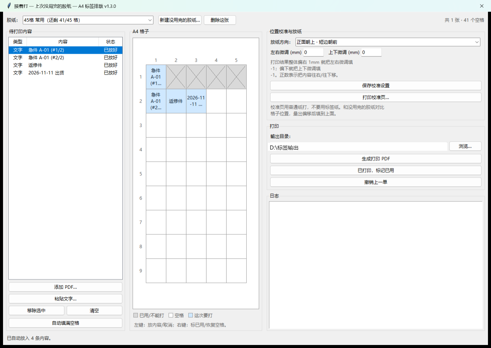
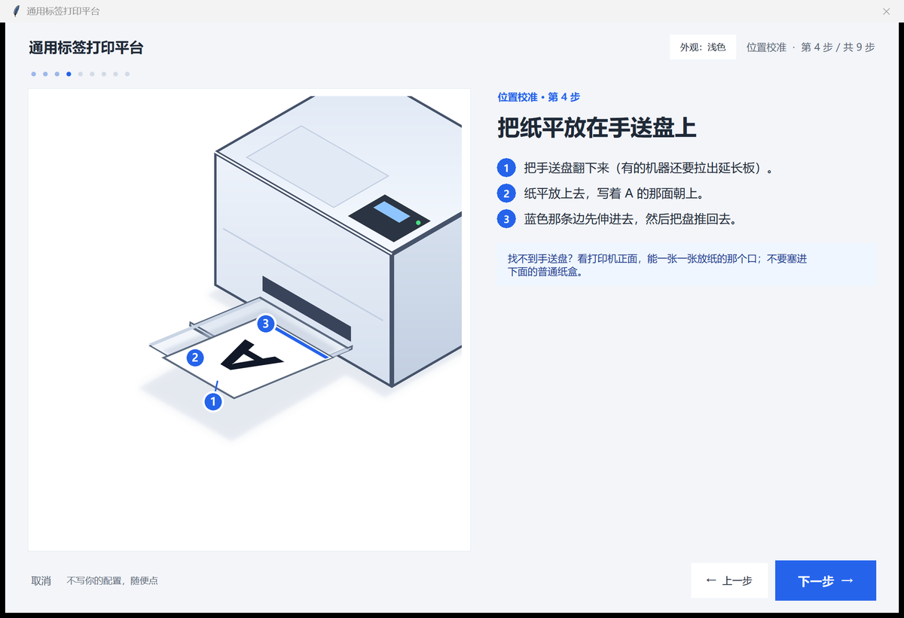
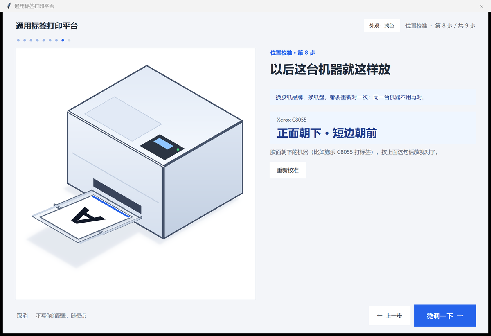

# 通用标签打印平台（ulpp）

简体中文 | [English](README.en.md)

把 **PDF 页面里的若干小块**，或**一段文字**，按份数排进 A4 预切不干胶的格子里，输出可直接打印的 PDF。

两种输入：

1. **表格型 PDF** —— 页面本身是“一格一条记录”的表格。工具会按文字锚点找出每一格，
   把这一格的内容原样抠出来、等比缩放进标签格，内容保持矢量（不是截图）。
2. **一段文字** —— 一行一张，自动折行、自动选字号，渲染成 600dpi 位图。

内置 14 种常见 A4 标签纸规格，也可自定义列数、格宽、节距、边距。
界面支持中文 / English，命令行 `--lang zh|en`，默认跟随系统（系统语言不是中英时用英文）；
Windows 下双击 exe 就能用，也能命令行批量跑。
从 v1.3.0 起还支持**接着打**：上次没用完的胶纸，记住哪些格子空了，只打空格，不用攒满一整版。



> 最初是为了摆脱琐碎手工排版的“案牍之劳形”。
> 后来加了文字模式和胶贴规格。


## 功能

- **按份数复制**：格子里读到“数量 2”就出 2 张，“数量 10”出 10 张，同一张连排，方便分发
- **矢量裁剪**：整格内容按矢量缩放入格，放大不糊；文字标签用 600dpi 位图，不内嵌字体，PDF 只有几十 KB
- **文字自动排版**：自动折行、自动选字号；对齐可选居中/左/右；可整批“统一字号”。
  行尾写 `|2` 或 ` ×2` 表示这张印 2 份（`120×80×6` 这类尺寸不会被误判）
- **两种内容可混排**：PDF 卡片在前，文字标签接在后面，一起填满一版
- **一次出三个文件**：打印版（无网格线）、网格参考版（浅灰网格线，试打对位）、标签清单 CSV
- **内置常见规格**：下拉选中就把列数/格宽/节距/边距填好，再按实际胶纸微调
- **中英双语**：界面右下角可即时切换，或命令行 `--lang zh|en`；规格名、按钮、提示、输出文件名都会跟着变
- **位置校准向导**：不用懂“正面朝下·短边朝前”这种术语，看图回答两个问题（字在哪一面 / TOP 箭头在哪条边），
  自动推出这台机器该怎么放纸，以后自动带出
- **接着打**：上次没用完的胶纸也能继续用；图形化看到哪些格子空了，点格放置或自动填满，生成单页 PDF；带普通纸校准页和左右/上下微调
- **输入支持 PDF / 文件夹 / ZIP**（中文文件名的 ZIP 会自动纠正编码）

## PDF 卡片模式是怎么认的

- 以“文件名称”这类字段当**锚点**找卡片；份数读“数量”字段
- 字段名写在 `src/ulpp/parser.py` 顶部（`FIELD_LABELS` 和几个正则里），
  换一套模板时改这几个常量即可，不用动排版逻辑
- 一页有几列几行**不写死**，按锚点位置聚类推断；表格线会被识别并剔除，不会跟着缩进标签
- 一格里没有锚点时，这张卡片会被跳过，并在日志里提示

## 内置标签纸规格

| 预设 | 列×行 | 单格 |
| --- | --- | --- |
| 45 格（实测量过的规格） | 5×9 | 40 × 30 mm，节距 41.5×32 |
| 24 格 | 3×8 | 70 × 37 mm |
| 21 格 | 3×7 | 70 × 42.3 mm |
| 30 格 | 3×10 | 70 × 29.7 mm |
| 12 格 | 2×6 | 99 × 49.5 mm |
| 10 格 | 2×5 | 99 × 59.4 mm |
| 8 格 | 2×4 | 99 × 74.25 mm |
| 6 格 | 2×3 | 99 × 99 mm |
| 4 格 | 2×2 | 105 × 148.5 mm |
| 2 格 | 1×2 | 210 × 148.5 mm |
| 40 格 | 4×10 | 48 × 25 mm |
| 72 格 | 6×12 | 33 × 23 mm |
| 65 格 | 5×13 | 38 × 22 mm |
| 44 格 | 4×11 | 46 × 25 mm |

> 每家标签纸的裁切线会差 0.5~1mm。选中预设后先打一张“网格参考版”，跟实际胶纸透光叠对；
> 不合适就改“行节距 / 上边距 / 安全边”三个数字重出。
>
> 命令行里也可以用稳定 id：`--preset 45`、`--preset 24`；英文名和旧版中文名同样能用。

## 三种用法

### 1. 免安装：下载 exe

去 [Releases](../../releases) 下载 `ulpp.exe`，双击运行，不用装 Python。

> 未签名的 exe 可能被 Windows Defender / SmartScreen 拦一下：点“更多信息 → 仍要运行”。
> 介意的话用下面的源码方式，效果完全一样。

### 2. 源码运行

```bash
git clone https://github.com/Imensama/ulpp.git
cd ulpp
pip install -r requirements.txt
pip install -e .            # 让 python -m ulpp 找到 src 下的包
python run_gui.pyw          # Windows 图形界面
python -m ulpp     # 各平台通用（无参数即开界面）
```

> 不想 `pip install -e .` 的话，在 PowerShell 里 `$env:PYTHONPATH="src"` 也能跑。

### 3. 命令行（适合批量 / 定时）

> 以下命令在仓库根目录执行；源码运行时先 `pip install -e .`（或 `$env:PYTHONPATH="src"`）。

```bash
# 表格型 PDF
python -m ulpp 输入.zip -o 输出目录
python -m ulpp 某个目录 --first-page-only --no-proof
python -m ulpp 表单.pdf --preset 24

# 纯文字（一行一张，|2 = 印两份）
python -m ulpp --text "急件 A-01 |2" --text "返修件" -o 输出目录
python -m ulpp --text-file 清单.txt --text-uniform

# 英文界面（--lang en；不加则跟随系统）
python -m ulpp --lang en --text "URGENT A-01 |2" --text "REWORK" -o 输出目录
python -m ulpp --lang en --list-presets

# 两者混排
python -m ulpp 表单.pdf --text "加急 |2" --preset 45

python -m ulpp --list-presets        # 看所有规格
python -m ulpp --save-config g.json  # 存一套参数，下次 --config g.json
```

`python -m ulpp -h` 看全部参数。`--preset` 可以用稳定 id（`45`、`24`…）、英文名，或旧版中文名，
老脚本不用改。

## 界面怎么用

1. **① 添加 PDF**（可跳过）：点“添加 PDF / 文件夹 / 压缩包”，装了 `tkinterdnd2` 也能直接拖进列表
2. **② 文字标签**（可跳过）：一行一张，行尾 `|2` 表示两份；可选对齐和“统一字号”
3. **③ 生成选项**：全部页 / 仅第 1 页；是否出网格参考版和清单；输出目录
4. **④ 标签纸规格与版式参数**：先选规格，尺寸自动填好，再按实际裁切线微调
5. 点 **开始生成**，完成后点“打开输出文件夹”
6. 右下角 **语言 / Language** 下拉可在“中文 / English”之间即时切换，文件列表、文字和参数都会保留；
   不选时按 `--lang` > 环境变量 `LC_ALL`/`LANG` > 系统语言；系统语言不是中文/英文时默认英文
7. 右下角 **接着打…** 打开没用完的胶纸窗口；整版打印流程不变

## 位置校准向导（v1.3.1）

“正着放还是反着放、哪条边先伸进去”，这件事每台机器都不一样，说明书上还常常写反。
向导把它变成两个不用懂打印机就能答的问题。

入口：**接着打** 窗口 → 位置校准与放纸 → **不知道怎么放？用校准向导…**
（旁边的“放纸方向”下拉框保留，已经知道答案的人可以直接选。）



九步：选机器 → 写个大 A → 确认 A 面朝上 → 放上手送盘（带放纸动画）→
打一张方向测试页（普通纸）→ 问“字在哪一面” → 问“TOP 箭头在哪条边” → 结论 → 左右/上下微调。



- 测试页是 **A4 300dpi 普通纸**，带 TOP 箭头、大 A、粗黑条，翻到背面也看得出哪面着墨；
  打印时必须 **100% 实际大小**，不要用“适应页面”
- 结果写进这台机器/纸盘的校准配置（就是下拉框那四个值），下次自动带出
- 支持中文 / English，两套皮肤（浅色 / 黑白）

> 它只解决**方向**，不解决**标签尺寸**。纸张的实际切割位置要靠扫描量（见“限制”）。

## 接着打（上次没用完的胶纸）

主界面右下角点 **接着打…**，会打开一个独立窗口（整版打印流程不受影响）。

1. **新建一张没用完的胶纸**：选内置规格，或选“自定义”填列数/行数/格宽/节距（比如 3×4）。
2. **标已用格**：用过的格子右键点一下变灰；点错了再右键恢复。
3. **放内容**：左边加 PDF 卡片或粘贴文字；选中一条内容，左键点空格=“打在这儿”；也可以点“自动填满空格”。
4. **生成打印 PDF**：只包含选中的格子，其他位置留白；打印时选 **实际大小 100%**，一次放一张。
5. **打印后标记已用**：点“已打印，标记已用”，这些格子变灰；点错了点“撤销上一单”。
6. **位置校准**：点“打印校准页…”生成一张**普通纸**参考页，和没用完的胶纸对比格子位置；
   整体偏右/偏下多少 mm，就在左右/上下微调里填对应的负数。校准页不会印在胶纸上，也不会污染标签。

记录存在 `%APPDATA%\ulpp\sheets.json`（Windows）或 `~/.config/ulpp/sheets.json`；
旧版 `inventory.json` 会自动迁移。

限制（v1.3.1）：

- **内置规格只能当起点**：A4 不干胶各厂各批的切割尺寸都不一样（实测同一款 45 格纸，
  标称节距 41.5 mm，量出来是 42.26 mm —— 打到第 5 列就偏大约 3 mm）。
  目前靠“网格参考版 + 左右/上下微调”手工对齐；下一步用**扫描识别**一次量准（不需要联网、不依赖 AI）
- 空格需要人工维护一次；扫描自动识别格子还在规划里
- 只能打**标签还贴着**的格子；已经撕掉标签的格子标成已用，不要打（硅油衬纸不着墨）
- 消费级打印机重复放纸有 ±1~2mm 误差；请先用校准页 + 一张试打
- 激光优先；喷墨在用过的不干胶纸上更容易蹭墨/卷曲，建议先试
- 暂不支持 A3；纸张尺寸已留在数据结构里，后续可加

## 输出

| 文件 | 用途 |
| --- | --- |
| `*_打印版.pdf` | 直接上胶纸打印（无网格线） |
| `*_网格参考版.pdf` | 普通纸试打，和胶纸透光叠对，检查格子对位 |
| `*_标签清单.csv` | 每张标签在第几版第几格、来源（PDF/文字）、名称、数量、第几份 |
| `*_接着打.pdf` | 只打没用完的胶纸上的空格 |
| `*_接着打清单.csv` | 接着打的格子清单 |

> 文件名也跟着界面语言走：中文界面是 `*_打印版.pdf`、`*_网格参考版.pdf`、`*_标签清单.csv`、
> `*_接着打.pdf`、`*_接着打清单.csv`；英文界面是 `*_print.pdf`、`*_grid-reference.pdf`、
> `*_label-list.csv`、`*_continue.pdf`、`*_continue-list.csv`。默认前缀 `标签` / `label`，
> 默认输出目录 `标签输出` / `label-output`。

## 目录结构

```
ulpp/
├─ src/ulpp/
│  ├─ config.py      # 版式参数（GridSpec）
│  ├─ presets.py     # 常见 A4 标签纸规格
│  ├─ parser.py      # 解析 PDF：找卡片、读字段、算内容框
│  ├─ textlabel.py   # 文字排版：切词、折行、自动选字号、渲染位图
│  ├─ imagex.py      # 把位图写成 PDF 图像 XObject（1bit + Flate 压缩）
│  ├─ builder.py     # 拼版输出：Form XObject / 图像 + 裁剪 + 缩放
│  ├─ sheets.py      # 没用完的胶纸记录：已用格、位置校准配置
│  ├─ calibration.py # 普通纸校准页
│  ├─ partial_gui.py # 接着打窗口（网格、放置、标记已用）
│  ├─ i18n.py        # 运行时多语言：JSON 语言包、系统语言识别、tr()
│  ├─ locales/       # zh_CN.json / en_US.json
│  ├─ cli.py         # 命令行
│  ├─ gui.py         # 图形界面（tkinter）
│  └─ __main__.py    # 有参数走 CLI，无参数开界面
├─ packaging/        # PyInstaller 打包配置与脚本
├─ tests/            # 单元测试
└─ .github/workflows/build-windows.yml   # 打 tag 自动打包并发 Release
```

## 技术要点

- 解析用 **pdfplumber**（拿文字和线条坐标）：以字段名所在的词当锚点，按最近的列起点归格，
  同一格的词按 top 聚成行，从锚点行开始按字段名收行；遇到下一个“文件名称”就停。
- PDF 输出用 **pypdf**：源页做成 **Form XObject**（整页只内嵌一份），用「裁剪路径 + 缩放矩阵 + `Do`」
  画进小格。**裁剪框必须用内容区而不是整格**，否则安全边里会漏出相邻内容。
- 文字输出用 **Pillow** 渲染成 600dpi 1bit 图，写成 `/Image` XObject（Flate 压缩）。
  不内嵌中文字体：标签很小，位图印出来和矢量几乎看不出差别，PDF 也不会膨胀十几 MB。
- 表格线识别：细长且贯通整页的线判为格线剔除，避免把表格边框缩进标签。
- 多语言：两份 JSON 语言包，测试会校验 key 集合完全一致、占位符一致，并检查代码里用到的
  `tr()` key 都存在；语言包缺失或缺 key 时回退中文并在日志里警告，不中断运行。
- 接着打：`build_partial_pdf()` 只把指定格号画到一页上；左右/上下微调把格子整体平移后再裁剪，
  保证内容仍落在标签内。胶纸记录是本地 JSON，打印后由用户确认标记已用，支持撤销。

## 开发与打包

```bash
pip install -r requirements.txt
pip install -e .
python -m unittest discover -s tests -t .   # 82 个用例
```

```powershell
powershell -ExecutionPolicy Bypass -File packaging\build.ps1
# 产物：dist\ulpp.exe（单文件，约 36MB）
```

或者用 GitHub Actions：打 tag（如 `v1.3.0`）后自动构建并上传 Release 附件。

## 平台支持

| 平台 | 状态 | 需要额外装 |
| --- | --- | --- |
| Windows 10/11 | 主要支持，有 exe | 无 |
| macOS | 源码可跑 | Python 3.9+（官网安装包自带 tkinter；Homebrew 需 `brew install python-tk`） |
| Linux | 源码可跑 | `python3-tk`；文字模式需要字体：英文用 DejaVu Sans，中文用 `fonts-wqy-microhei` |

接着打需要打印机支持单张手送/侧供纸；纸盒放没用完的胶纸是否识别取决于机型。

exe 是 Windows 专用；mac/Linux 用 `python -m ulpp`。
“打开输出文件夹”按钮在 mac/Linux 上暂时只会弹提示，不会真的打开文件管理器。

## 常见问题

**Q：识别不到卡片？**
A：这个模式针对“每格一条记录”的表格型 PDF。扫描件（整页图片）或没有这些字段名的 PDF 取不到——
那种情况可以用文字模式手工粘，或者改 `parser.py` 顶部的字段名。

**Q：文字标签字号忽大忽小？**
A：默认每张尽量填满；勾上“统一字号”后整批用同一档（自动取放得下的最小值）。

**Q：一个字被挤到下一行？**
A：已经做了“孤字回拉”，极窄的格子里仍可能出现；把文字缩短或减小“安全边”即可。

**Q：某个格子的标签空白 / 只有一小条？**
A：多半是那一格的表格线被判成了内容。把 PDF 发个 issue，或先用 `--inset 1` 试试。

**Q：格子位置对不上？**
A：先打网格参考版，量出偏移，改“上边距”和“行节距”，或换一个更接近的规格预设。
接着打时，先在普通纸上打校准页，把左右/上下微调填好再打胶纸。

**Q：上次没用完的胶纸怎么接着打？**
A：点“接着打…”，新建一张没用完的胶纸；右键把已经用过的格子标灰；把这次的内容放进空格；
打印后点“已打印，标记已用”。第一次用先打一张普通纸校准页，和不干胶纸对比格子位置。

**Q：能加条码 / 二维码吗？**
A：目前不生成；源 PDF 里已有的会被原样抠过来。需要生成可以基于 `textlabel.py` 扩展。

## 许可

[MIT](LICENSE)。第三方组件均为宽松协议（MIT / BSD / PSF / MIT-CMU），可以随 exe 分发到 Releases。
详见 [THIRD-PARTY-NOTICES.md](THIRD-PARTY-NOTICES.md)。
