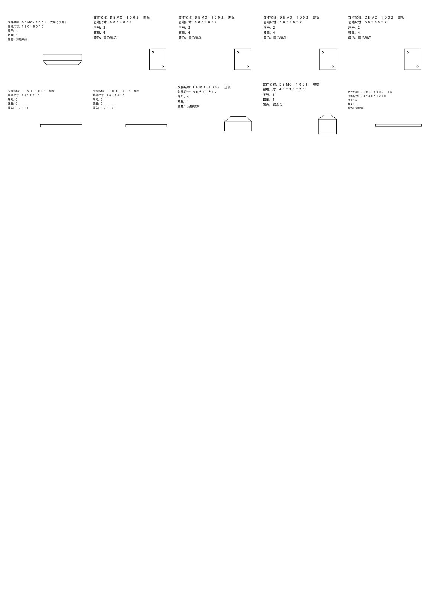
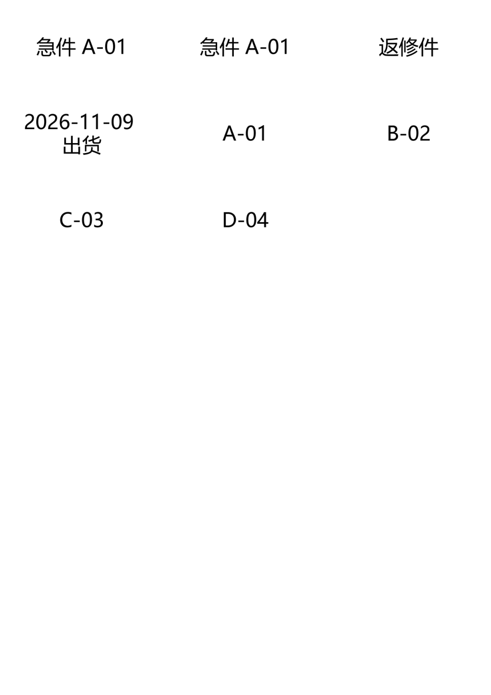

# A4 标签排版（label-sheet）

把 **PDF 页面里的若干小块**，或**一段文字**，按份数排进 A4 预切不干胶的格子里，输出可直接打印的 PDF。

两种输入：

1. **表格型 PDF** —— 页面本身是“一格一条记录”的表格。工具会按文字锚点找出每一格，
   把这一格的内容原样抠出来、等比缩放进标签格，内容保持矢量（不是截图）。
2. **一段文字** —— 一行一张，自动折行、自动选字号，渲染成 600dpi 位图。

内置 14 种常见 A4 胶贴规格，也可自定义列数、格宽、节距、边距；Windows 下双击 exe 就能用，也能命令行批量跑。

> 最初是为了摆脱琐碎手工排版的“案牍之劳形”。
> 后来加了文字模式和胶贴规格。




## 功能

- **按份数复制**：格子里读到 `数量 2` 就出 2 张，`数量 10` 出 10 张，同一张连排，方便分发
- **矢量裁剪**：整格内容按矢量缩放入格，放大不糊
- **文字标签用位图**：600dpi 1bit，不内嵌字体，45 张标签的 PDF 只有几十 KB
- **文字自动排版**：自动折行、自动选字号；对齐可选居中/左/右；可整批“统一字号”。
  行尾写 `|2` 或 `×2` 表示这张印 2 份（`120×80×6` 这类尺寸不会被误判）
- **两种内容可混排**：PDF 卡片在前，文字标签接在后面，一起填满一版
- **一次出三个文件**：生产版（无刀线）、刀线校样版（浅灰刀线，试打对位）、标签清单 CSV
- **内置常见规格**：下拉选中就把列数/格宽/节距/边距填好，再按实际胶纸微调
- **输入支持 PDF / 文件夹 / ZIP**（中文文件名的 ZIP 会自动纠正编码）

## PDF 卡片是怎么识别的

- 以“文件名称”这类字段当**锚点**找到每一格，份数读“数量”字段
- 一页有几列几行**不写死**，按锚点位置推断；表格线会被剔除，不会跟着缩进标签
- 想换成别的模板：改 `parser.py` 顶部的字段名常量即可（细节见「技术要点」）

## 内置胶贴规格

| 预设 | 列×行 | 单格 |
| --- | --- | --- |
| 45 格（实测校准过） | 5×9 | 40 × 30 mm，节距 41.5×32 |
| 24 格 | 3×8 | 70 × 37 mm |
| 21 格 | 3×7 | 70 × 42.3 mm |
| 30 格 | 3×10 | 70 × 29.7 mm |
| 12 格 | 2×6 | 99 × 49.5 mm |
| 10 格 | 2×5 | 99 × 59.4 mm |
| 8 格 | 2×4 | 99 × 74.25 mm |
| 6 格 | 2×3 | 99 × 99 mm |
| 4 格 | 2×2 | 105 × 148.5 mm |
| 2 格 | 1×2 | 210 × 148.5 mm |
| 40 格 | 4×10 | 48 × 25 mm |
| 72 格 | 6×12 | 33 × 23 mm |
| 65 格 | 5×13 | 38 × 22 mm |
| 44 格 | 4×11 | 46 × 25 mm |

> 每家胶纸的刀线会差 0.5~1mm。选中预设后先打一张“刀线校样版”，跟真胶纸透光叠对；
> 不合适就改“行节距 / 上边距 / 安全边”三个数字重出。

## 三种用法

### 1. 免安装：下载 exe

去 [Releases](../../releases) 下载 `标签排版.exe`，双击运行，不用装 Python。

> 未签名的 exe 可能被 Windows Defender / SmartScreen 拦一下：点“更多信息 → 仍要运行”。
> 介意的话用下面的源码方式，效果完全一样。

### 2. 源码运行

```bash
git clone https://github.com/Imensama/label-sheet.git
cd label-sheet
pip install -r requirements.txt
python run_gui.pyw      # Windows 图形界面
python -m label_sheet   # 各平台通用（无参数即开界面）
```

### 3. 命令行（适合批量 / 定时）

```bash
# 表格型 PDF
python -m label_sheet 输入.zip -o 输出目录
python -m label_sheet 某个目录 --first-page-only --no-proof
python -m label_sheet 表单.pdf --preset "24格 70×37（3×8）"

# 纯文字（一行一张，|2 = 印两份）
python -m label_sheet --text "急件 A-01 |2" --text "返修件" -o 输出目录
python -m label_sheet --text-file 清单.txt --text-uniform

# 两者混排
python -m label_sheet 表单.pdf --text "加急 |2" --preset "45格 40×30（5×9，常用）"

python -m label_sheet --list-presets        # 看所有规格
python -m label_sheet --save-config g.json  # 存一套参数，下次 --config g.json
```

`python -m label_sheet -h` 看全部参数。

## 界面怎么用

1. **① 添加 PDF**（可跳过）：点“添加 PDF / 文件夹 / 压缩包”，装了 `tkinterdnd2` 也能直接拖进列表
2. **② 文字标签**（可跳过）：一行一张，行尾 `|2` 表示两份；可选对齐和“统一字号”
3. **③ 生成选项**：全部页 / 仅第 1 页；是否出刀线校样版和清单；输出目录
4. **④ 规格与参数**：先选胶贴规格，尺寸自动填好，再按实际刀线微调
5. 点 **开始生成**，完成后点“打开输出文件夹”

## 输出

| 文件 | 用途 |
| --- | --- |
| `*_生产版.pdf` | 直接上不干胶纸打印（无色标线） |
| `*_刀线校样版.pdf` | 普通纸试打，和不干胶纸透光叠对，检查刀线对位 |
| `*_标签清单.csv` | 每张标签在第几版第几格、来源（PDF/文字）、名称、数量、第几份 |

## 目录结构

```
label-sheet/
├─ src/label_sheet/
│  ├─ config.py      # 版式参数（GridSpec）
│  ├─ presets.py     # 常见 A4 胶贴规格
│  ├─ parser.py      # 解析 PDF：找卡片、读字段、算内容框
│  ├─ textlabel.py   # 文字排版：切词、折行、自动选字号、渲染位图
│  ├─ imagex.py      # 把位图写成 PDF 图像 XObject（1bit + Flate 压缩）
│  ├─ builder.py     # 拼版输出：Form XObject / 图像 + 裁剪 + 缩放
│  ├─ cli.py         # 命令行
│  ├─ gui.py         # 图形界面（tkinter）
│  └─ __main__.py    # 有参数走 CLI，无参数开界面
├─ packaging/        # PyInstaller 打包配置与脚本
├─ tests/            # 单元测试
└─ .github/workflows/build-windows.yml   # 打 tag 自动打包并发 Release
```

## 技术要点

- 解析用 **pdfplumber**（拿文字和线条坐标）：以字段名所在的词当锚点，按最近的列起点归格，
  同一格的词按 top 聚成行，从锚点行开始按字段名收行；遇到下一个“文件名称”就停。
- PDF 输出用 **pypdf**：源页做成 **Form XObject**（整页只内嵌一份），用「裁剪路径 + 缩放矩阵 + `Do`」
  画进小格。**裁剪框必须用内容区而不是整格**，否则安全边里会漏出相邻内容。
- 文字输出用 **Pillow** 渲染成 600dpi 1bit 图，写成 `/Image` XObject（Flate 压缩）。
  不内嵌中文字体：标签很小，位图印出来和矢量几乎看不出差别，PDF 也不会膨胀十几 MB。
- 表格线识别：细长且贯通整页的线判为格线剔除，避免把表格边框缩进标签。
- 字段名与识别规则都在 `src/label_sheet/parser.py` 顶部：`FIELD_LABELS` 定义字段行，
  名称 / 尺寸 / 数量各有一个正则；一格里没有锚点的会被跳过，并写进日志。

## 开发与打包

```bash
pip install -r requirements.txt
python -m unittest discover -s tests -t .
```

```powershell
powershell -ExecutionPolicy Bypass -File packaging\build.ps1
# 产物：dist\标签排版.exe（单文件，约 36MB）
```

或者用 GitHub Actions：打 tag（如 `v1.1.0`）后自动构建并上传 Release 附件。

## 平台支持

| 平台 | 状态 | 需要额外装 |
| --- | --- | --- |
| Windows 10/11 | 主要支持，有 exe | 无 |
| macOS | 源码可跑 | Python 3.9+（官网安装包自带 tkinter；Homebrew 需 `brew install python-tk`） |
| Linux | 源码可跑 | `python3-tk`；文字模式另需中文字体（如 `fonts-wqy-microhei`） |

exe 是 Windows 专用；mac/Linux 用 `python -m label_sheet`。
“打开输出文件夹”按钮在 mac/Linux 上暂时只会弹提示，不会真的打开文件管理器。

## 常见问题

**Q：识别不到卡片？**
A：这个模式针对“每格一条记录”的表格型 PDF。扫描件（整页图片）或没有这些字段名的 PDF 取不到——
那种情况可以用文字模式手工粘，或者改 `parser.py` 顶部的字段名。

**Q：文字标签字号忽大忽小？**
A：默认每张尽量填满；勾上“统一字号”后整批用同一档（自动取放得下的最小值）。

**Q：一个字被挤到下一行？**
A：已经做了“孤字回拉”，极窄的格子里仍可能出现；把文字缩短或减小“安全边”即可。

**Q：某个格子的标签空白 / 只有一小条？**
A：多半是那一格的表格线被判成了内容。把 PDF 发个 issue，或先用 `--inset 1` 试试。

**Q：刀线对不上？**
A：先打校样版，量出 X/Y 偏移，改“上边距”和“行节距”，或换一个更接近的规格预设。

**Q：能加条码 / 二维码吗？**
A：目前不生成；源 PDF 里已有的会被原样抠过来。需要生成可以基于 `textlabel.py` 扩展。

## 许可

[MIT](LICENSE)。第三方组件均为宽松协议（MIT / BSD / PSF / MIT-CMU），可以随 exe 分发到 Releases。
详见 [THIRD-PARTY-NOTICES.md](THIRD-PARTY-NOTICES.md)。
